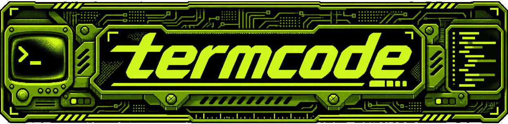
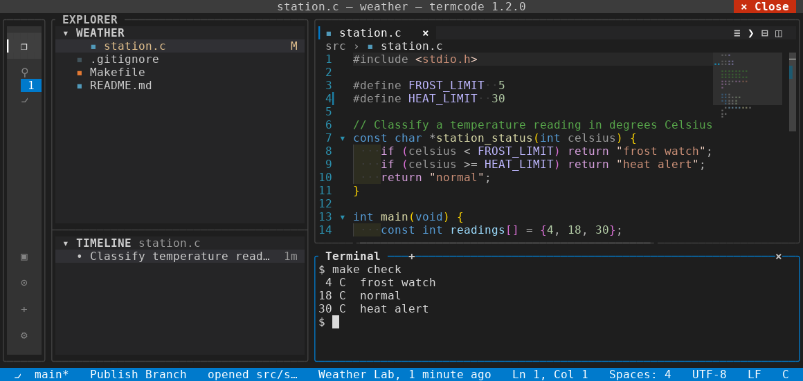
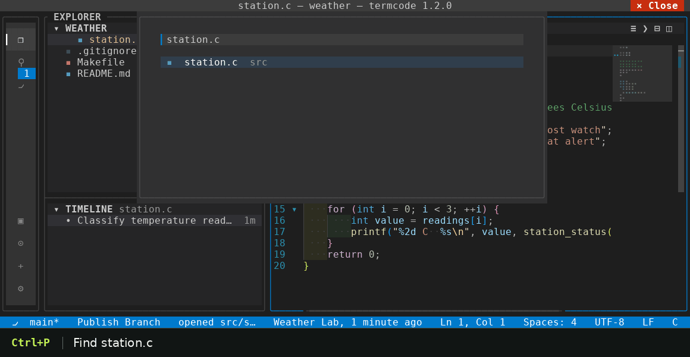
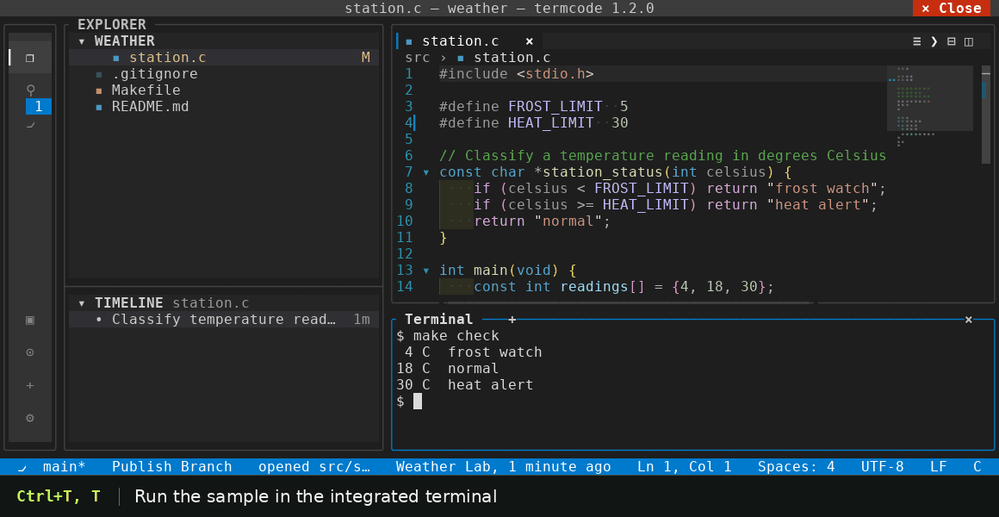
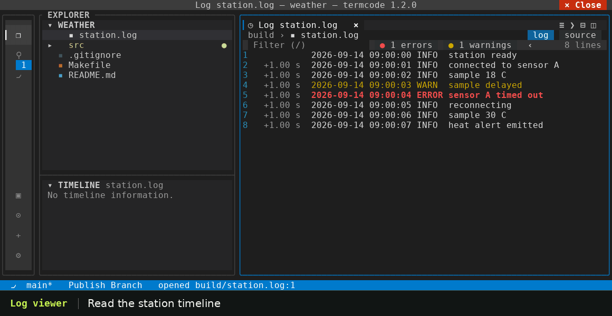

<!-- dev -->
<h1 align="right"></h1>

<p align="center">
  <a href="https://crates.io/crates/termcode"></a>
  <a href="https://github.com/JonasAtelier/termcode/actions/workflows/ci.yml?query=branch%3Amain"></a>
  <a href="LICENSE"></a>
</p>


<!-- /dev -->
<!-- user
# termcode
user -->

Edit code, run it and review the diff in one Linux terminal. Open a project folder to get a file explorer, split editors, a shell and a Git commit graph. termcode also runs as a Code tab in herdr.

## Install

With Rust 1.93 or newer and a C linker on Linux, install the published crate and open your project folder.

```sh
cargo install termcode --locked
termcode .
```

Git enables Source Control and ripgrep (`rg`) enables project search. Press **Ctrl+P** to open a file, **Ctrl+S** to save, **F1** to see commands and **Ctrl+Q** to quit. To open directly at a line, run `termcode README.md:12`.

<details>
<summary>Debian, Ubuntu and herdr</summary>

On Debian or Ubuntu, check your architecture with `dpkg --print-architecture`, download the matching package and run `sudo apt install ./termcode_*.deb`. [Latest release](https://github.com/JonasAtelier/termcode/releases/latest)

To add a Code tab in herdr 0.9.1+ from the Debian package, run `herdr plugin link /usr/share/termcode`, then `termcode --tab .`.

</details>

## See it in action

The three demos follow a small weather station from a temperature threshold in the source to the output of the compiled program.
<!-- user

[Watch the animated demos on GitHub](https://github.com/JonasAtelier/termcode#see-it-in-action)
user -->

<a id="open-your-first-file"></a>
<a id="edit-a-file"></a>

### Find your way around a project

- **Quick Open.** Press **Ctrl+P** and type part of a filename to open `station.c`.
- **Go to Symbol.** Type `@station` in Quick Open and press **Enter** to jump to `station_status`.
- **Project search.** Press **Ctrl+T**, then **S**, and search for `HEAT_LIMIT` to see where the threshold is defined and used.
- **Markdown preview.** Open the README, press **Ctrl+K**, then **V**. The temperature table renders beside its Markdown source.

<!-- dev -->

<!-- /dev -->

<a id="review-changes"></a>

### Run and review a change

- **Integrated terminal.** Press **Ctrl+T**, then **T**, to open a shell under the code. In the demo, `make check` runs three sample readings and prints a heat alert at 30 °C.
- **Side-by-side diff.** Press **Ctrl+G** and select the changed file. The red and green lines show the heat threshold moving from 32 to 30.
- **Commit graph.** Expand a commit under **Graph**, then select a file to read the changes introduced by that commit.
- **git's pager in a window.** In termcode's terminal, `git log`, `git diff` or `git show` opens over the editor, with its branch above. Page it as in less: **/** searches, **&** keeps matching lines, a drag and **Ctrl+C** copy, a click on a commit hash copies it, **q** closes it and returns to the prompt. Settings › Assist Key turns it off, or off for single commands.

<!-- dev -->

<!-- /dev -->

If a repository's Git settings can run external programs, Source Control asks you to trust it before enabling Git.

### Inspect logs, binaries and editor state

- **Log viewer.** Open a `.log` file and choose **log** on its toolbar. Press **/** and type `sensor` to isolate the connection and timeout messages. **F8** jumps to the next problem.
- **ELF inspector.** Open a compiled Linux binary to see its architecture and shared libraries. With `readelf` from GNU binutils installed, you can switch between the report, section sizes and a hexdump.
- **Editor API.** From termcode’s terminal, read the branch and changed paths that Source Control sees. The API returns JSON for a script or agent to consume.

```sh
termcode api state.get '{"path":"/git"}'
```

<!-- dev -->

<!-- /dev -->

## Serial ports

Install **Serial (xcomm)** from the **+** view or run the command below. Cargo builds the extension.

```sh
termcode ext install https://github.com/JonasAtelier/termcode#extensions/xcomm
```

Choose **Monitor** to watch a port in an editor tab and **Attach** to send input. The panel beside the tab controls baud rate, line format, DTR/RTS and capture. A disconnected adapter reopens when reattached. Add a note to identify a device, or drive an open channel with `serial.*` API calls or `xcomm ctl`. [xcomm](https://crates.io/crates/xcomm)

## Scripts and AI agents

Scripts can read unsaved buffers and diagnostics, apply edits as one undo step, and use the integrated terminal. termcode asks before an external program changes files or runs commands. Set `termcode.api` to `"read-only"` or `"off"` in Settings to limit access.

`termcode api --skill` prints the agent guide. `termcode mcp` serves the tools over MCP. For a session without a terminal UI, run `termcode --headless --api-stdio`.

## Extensions

The **+** view lists installed, built-in and suggested views. Install from a Git URL or local folder, enable or disable a view, or remove an extension. To build one, run `termcode ext new mine` for a starter or `termcode ext --skill` for the authoring guide. [Extension guide](https://github.com/JonasAtelier/termcode/blob/main/doc/extensions.md)

## Help and settings

**Ctrl+,** opens Settings. The Debian package includes `man termcode`. For more shortcuts, previews and troubleshooting, see the [0.4.0 user guide](https://github.com/JonasAtelier/termcode/blob/v0.4.0/README.md).

To report a problem, press **F1**, choose **Help: Report Issue** and review the copied diagnostics. [Issue tracker](https://github.com/JonasAtelier/termcode/issues/new/choose)

<!-- dev -->
## Run from source

From this checkout on Linux, run `cargo run -- .`. To register it with herdr 0.9.1+, run `herdr plugin link "$PWD"`. [Development guide](AGENTS.md) · [Changelog](CHANGELOG.md)
<!-- /dev -->

## License and credits

<!-- dev -->
© 2026 JonasAtelier · [MIT license](LICENSE)
<!-- /dev -->

Default colors come from Microsoft’s VS Code and file icons from Jesse Weed’s Seti UI, both under MIT. The Debian package includes its terms and dependency licenses in `/usr/share/doc/termcode/copyright` and `/usr/share/doc/termcode/THIRD-PARTY-LICENSES`.

## macOS (experimental)

Install with `cargo install termcode --locked` (Rust 1.93 or newer), or download
`termcode-aarch64-apple-darwin.tar.gz` (Apple Silicon) or `termcode-x86_64-apple-darwin.tar.gz`
(Intel) from [Releases](https://github.com/JonasAtelier/termcode/releases/latest), then run
`termcode .`. The editor, integrated terminal, API, clipboard, Trash (Finder's),
links (`open`) and serial ports (`/dev/cu.usb*`, up to 2000000 baud) work on macOS.
Picture icons need a Nerd Font found by fontconfig (`brew install fontconfig`).
Physical hardware integrations have not been validated on macOS.
