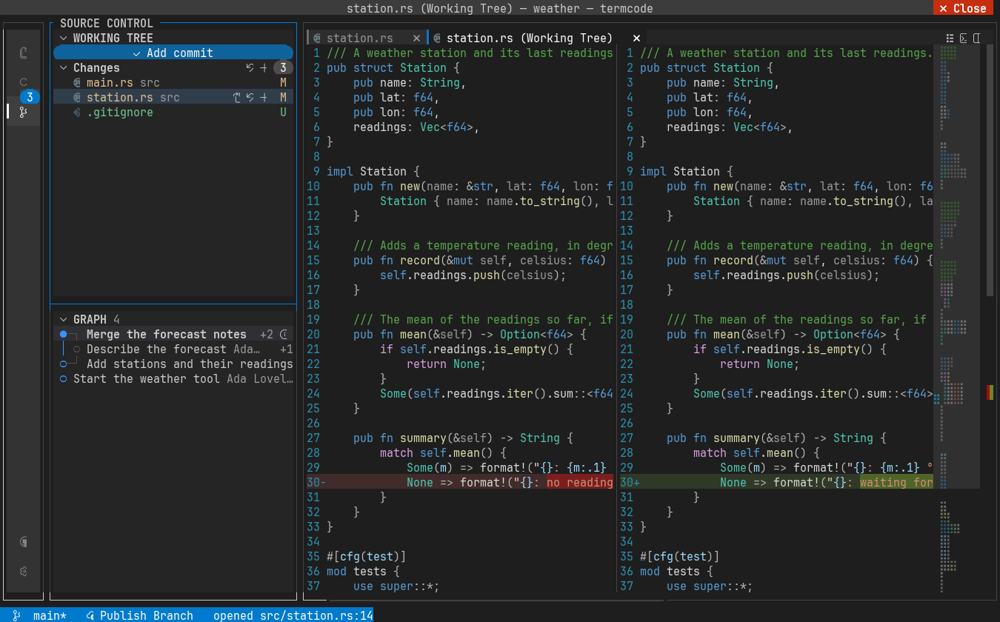

# termcode

A VS Code-style code editor and Git panel that runs **inside your terminal**.

- Run `termcode` in a folder and it opens right there, like `vim`. Quit and you are back at your shell.
- Inside [herdr](https://herdr.dev), `termcode --tab` opens it as a **Code** tab instead.

**What you get:** Explorer, Search, Source Control with a commit graph, tabs and split
editors, side-by-side diffs, a minimap, terminals, Go to Definition, error checking for
shell and C/C++, VS Code themes and keys. It also shows pictures, PDFs, Markdown as
GitHub does, patches as diffs, logs, ELF and linker-map sizes, your GitHub account, and
programs STM32, Arduino and ESP-IDF boards.





### Is it for you?

For working on code where your terminal already is: over SSH, in tmux or herdr, or when a
full IDE is too heavy and vim too bare. It has VS Code's look and keys, but it is not VS Code:

| termcode has | termcode doesn't have |
|---|---|
| Editing, Explorer, Search, Source Control, diffs, terminals | Extensions |
| Go to Definition and references, found by searching the code | A language server: no completion, no type-aware rename |
| Error checking for shell scripts and C/C++ | A debugger, remote development |
| VS Code themes and keys | Settings Sync |

### How light is it?

| | termcode | VS Code 1.146 |
|---|---|---|
| Start, until a file shows | **0.1 s** | 1.0 s |
| Memory | **19 MB** | 949 MB |
| Installed | **12 MB**, one file | 573 MB |

Details, and Neovim, under [Performance](#performance).

---

<!-- user
## 1. Install

Linux, x86_64 or arm64. On Debian or Ubuntu, add the apt repository once, then install:

```sh
sudo curl -fsSLo /usr/share/keyrings/termcode.gpg https://jonasatelier.github.io/termcode-releases/termcode.gpg
echo "deb [signed-by=/usr/share/keyrings/termcode.gpg] https://jonasatelier.github.io/termcode-releases stable main" \
  | sudo tee /etc/apt/sources.list.d/termcode.list
sudo apt update && sudo apt install termcode
termcode --version
```

Or download the package from
[Releases](https://github.com/JonasAtelier/termcode-releases/releases) and
`sudo apt install ./termcode_*.deb`.

apt also installs git, ripgrep, xclip and shellcheck. For the rest
([What termcode uses](#what-termcode-uses)), run **`/usr/share/termcode/setup.sh`**: it
asks before each part (`--yes` takes the defaults, `--all` everything, `--dry-run` only
prints the commands) and leaves what is already there alone.

user -->
<!-- dev -->
## 1. What you need

| Tool | Why | Check |
|---|---|---|
| Linux, x86_64 or arm64 | the only supported OS | `uname -m` |
| Rust 1.88 or newer | to build termcode | `cargo --version` |
| A C linker (`cc`) | Rust needs it | `cc --version` |
| git, ripgrep (`rg`) | Source Control; Search and Go to Definition | `git --version`, `rg --version` |

The optional tools are in [What termcode uses](#what-termcode-uses).

```sh
sudo apt install git ripgrep build-essential shellcheck clang   # Debian / Ubuntu
sudo dnf install git ripgrep gcc ShellCheck clang               # Fedora
sudo pacman -S git ripgrep base-devel shellcheck clang          # Arch
curl --proto '=https' --tlsv1.2 -sSf https://sh.rustup.rs | sh  # Rust (then a new terminal)
```
<!-- /dev -->

## 2. Fonts and icons (nothing to do)

termcode uses your terminal's font and picks its icons by itself:

| You have | Icons |
|---|---|
| a [Nerd Font](https://www.nerdfonts.com/font-downloads) installed | VS Code's icons |
| no Nerd Font, or termcode runs over SSH | Unicode symbols: ❐ ⚲ ⎇ ⚙ ▸ ▾ × ● ✓ (any common monospace font) |

For VS Code's icons, install e.g. **JetBrainsMono Nerd Font** (unzip into
`~/.local/share/fonts/`, then `fc-cache -f`); over SSH, on the computer in front of you, and
set `"termcode.icons": "nerd"`.

### Terminals

| Terminal | Colours | Status |
|---|---|---|
| Ghostty, alone or in herdr | 24-bit | tested |
| tmux 3.6 | 24-bit | tested |
| GNU screen 4.9 | 256 or 16 | tested |
| Over SSH | 256 unless `TERM` names a 24-bit terminal | tested |
| Linux console | 16 | tested by its environment |
| GNOME Terminal, Ptyxis, Konsole, kitty, WezTerm, Alacritty, foot, iTerm2, Windows Terminal | 24-bit | should work |
| macOS Terminal | 256 | should work |

`termcode.colors` or `TERMCODE_COLORS=truecolor|256|16` overrides the colour depth.

<!-- dev -->
## 3. Build and install

```sh
git clone https://github.com/JonasAtelier/termcode.git
cd termcode
cargo install --path . --root ~/.local          # low on memory: add -j2
echo 'export PATH="$HOME/.local/bin:$PATH"' >> ~/.bashrc   # once; zsh: ~/.zshrc
```

For `man termcode` and Tab completion in bash (the .deb has them, for zsh and fish too):

```sh
mkdir -p ~/.local/share/man/man1 ~/.local/share/bash-completion/completions
cp doc/termcode.1 ~/.local/share/man/man1/
cp completions/termcode.bash ~/.local/share/bash-completion/completions/termcode
```

**Or as a .deb** (static: any Debian or Ubuntu; installs git, ripgrep, xclip, shellcheck):

```sh
cargo install cargo-deb                             # once
scripts/deb.sh                                      # -> target/deb/debian/, amd64 and arm64
sudo apt install ./target/deb/debian/termcode_*_$(dpkg --print-architecture).deb
```

Pick one way: with both, the `~/.local/bin` copy usually wins.

## 4. Add it to herdr (optional)

```sh
herdr plugin link "$PWD"                 # .deb install: herdr plugin link /usr/share/termcode
herdr plugin list                        # shows jonasatelier.termcode
```

herdr finds `termcode` on `PATH`: restart herdr after changing `PATH`.

## 5. Try it
<!-- /dev -->
<!-- user
## 2. Add it to herdr (optional)

```sh
herdr plugin link /usr/share/termcode
herdr plugin list                        # shows jonasatelier.termcode
```

## 3. Try it
user -->

```sh
cd ~/some/project
termcode                 # this folder; Ctrl+Q quits
termcode --tab           # in a herdr pane: a "Code: project" tab (click it in the tab bar)
```

## Updating

<!-- dev -->
```sh
git pull && cargo install --path . --root ~/.local
```
<!-- /dev -->
<!-- user
```sh
sudo apt update && sudo apt upgrade
```
user -->

An open termcode reloads itself a few seconds later, keeping its tabs, cursors and shells
(it waits while files are unsaved). By hand: F1 **Developer: Reload Window**.

## Uninstalling

<!-- dev -->
```sh
herdr plugin unlink jonasatelier.termcode
rm ~/.local/bin/termcode               # .deb install: sudo apt remove termcode
```
<!-- /dev -->
<!-- user
```sh
herdr plugin unlink jonasatelier.termcode
sudo apt remove termcode
sudo rm /etc/apt/sources.list.d/termcode.list /usr/share/keyrings/termcode.gpg   # the repository too
```
user -->

---

## Using it

### Opening things

```sh
termcode                    # this folder (its git repo if inside one)
termcode ~/proj             # any folder
termcode src/main.rs:120    # a file at a line (also :LINE:COL)
termcode --tab src          # the same, as a herdr tab
termcode --new ~/proj       # a second termcode, even inside one's terminal
```

- **From termcode's terminal**, `termcode PATH` opens PATH in this termcode: a file in
  place, another folder by switching to it (shells keep running; each folder keeps its own
  session). It waits while a Programmer job or Git write runs or a file is unsaved.
- **Sessions:** reopen a folder and its tabs, cursors and layout come back. Unsaved text
  survives a crash.
- **Subfolders:** `termcode drivers/net` shows that folder; Source Control uses the whole repo.
- **Quitting:** Ctrl+Q or Close in the title bar (asks about unsaved files).

### Keys

| Key | Does |
|---|---|
| F1 | Command palette (every command) |
| Ctrl+P | Open a file by name (`:42` a line, `@` a function) |
| Ctrl+S / Ctrl+W / Ctrl+Q | Save / close tab / quit |
| Ctrl+Z / Ctrl+Y | Undo / redo |
| Ctrl+F / Ctrl+H | Find / replace |
| Ctrl+/ | Toggle comment |
| Ctrl+Shift+Up / Down | Add a cursor above / below |
| Alt+Up / Down | Move lines |
| Ctrl+Shift+[ / ] | Fold / unfold |
| Alt+Z | Word wrap |
| F12 or Ctrl+click / Shift+F12 | Go to Definition / find references |
| Alt+← / Alt+→ | Back / forward |
| F7 / Shift+F7 | Next / previous change in a diff |
| Ctrl+PgDn / Ctrl+PgUp | Next / previous tab |
| Ctrl+Shift+V / Ctrl+K V | A file's other look ([below](#files-and-their-looks)) / Markdown preview to the side |
| Ctrl+` | Show / hide the terminal |
| Ctrl+, | Settings |

**Quick keys: Ctrl+T, then one key**, wherever the keys are, the terminal too (so the
shell keeps its own keys). The list shows while it waits; Ctrl+T twice sends Ctrl+T, Esc
cancels.

| Key | | Key | |
|---|---|---|---|
| `t` | Show / hide the terminal | `o` | Outline |
| `c` · `n` · `p` | New · next · previous terminal | `m` | Minimap |
| `x` | Close the terminal (the last one: hide it) | `z` | Word wrap |
| `f` | Go to file | `v` | A file's other look |
| `s` | Search | `h` | Hexdump |
| `e` | Explorer | `[` · `]` | Previous · next tab |
| `g` | Source Control | ← ↑ ↓ → | The pane that way |
| `b` | Side bar | `,` | Settings |

**Your own keys:** any F1 command, by its name as F1 shows it. `termcode.prefixKeys`
changes the quick keys (`termcode.prefix` the prefix, `""` turns it off),
`termcode.keybindings` the others:

```jsonc
"termcode.prefixKeys": { "q": "File: Quit", "h": "" },     // "" removes one
"termcode.keybindings": { "ctrl+alt+p": "Git: Pull", "ctrl+q": "" }
```

Keys are `ctrl`, `alt`, `shift` joined with `+` to a letter, digit, symbol, `f1`-`f24`,
`enter`, `tab`, `esc`, `space`, `backspace`, `delete`, `home`, `end`, `pageup`, `pagedown`
or an arrow. Some terminals (GNOME Terminal, Ptyxis) can't send Ctrl+Shift keys, Ctrl+Tab
or Ctrl+1/2/3: use F1, the quick keys or your own.

### Files and their looks

A file opens as text; the buttons on its bar (or Ctrl+Shift+V, Ctrl+T `v`) switch it to
another look and back:

| File | Look | In it |
|---|---|---|
| Markdown | **preview**, as GitHub shows a README | Pictures beside it, tables, alerts, `<p align="center">`… |
| `.patch`, `.diff` | **diff**: each file side by side | `@@` lines, the files' own line numbers; F7 goes from change to change |
| `.log`, `syslog`, `dmesg` | **log**: any size | Errors and warnings coloured and counted, the time between lines; `/` filters, F8 or `n` the next problem, End follows the file as it grows |
| Linker `.map` | **usage** | Each memory region's use, sections, bytes by file and library |
| ELF (`.so`, `.o`, executables, firmware) | readelf's report, **hexdump** | Summed up first: SONAME, libraries, build ID, Flash and RAM |
| Binary, `.bin` | hexdump | F1 **View: Toggle Hexdump**: any file as one, or back to text |
| PNG, JPEG, GIF, WebP, BMP, ICO | the picture | `+` `-` zoom, `0` fits, `1` actual size, arrows pan |
| PDF | its pages | Scrollbar, wheel, PgUp/PgDn; ‹ › a page; **2 pages**; Ctrl+wheel zooms; select text and Ctrl+C; Ctrl+F finds; its contents in the Outline; **text** shows its text |

Pictures, PDFs and the minimap use real pixels in Ghostty and kitty, half-blocks elsewhere.

### The mouse

- Click a file to preview it (italic tab); double-click the tab to keep it.
- Drag a file to an editor's edge to split; drag any divider to resize.
- In the Explorer: double-click a name to rename; drag onto a folder to move (hold Ctrl or
  Alt as you let go: copy); Ctrl+click, Shift+click, Shift+↑↓, Ctrl+A select several.
- Ctrl+C / X / V copy and move files (`name (1)` when the name is taken; Esc stops a big
  copy). Delete moves to the Trash, Shift+Delete deletes for good (each asks). Ctrl+Z / Y
  takes back or redoes them, even after a reload.
- Rest the pointer on a file for its MD5, a symlink for its target, a function for its docs.

### Panels

| Panel | Open with | |
|---|---|---|
| Explorer | Alt+1, Ctrl+E | Files; **Timeline** below: the open file's commits. Follows the active editor |
| Search | Alt+4, F4 | All files; arrows show each match as they land on it. **References** below |
| Source Control | Alt+2, F2, Ctrl+G | Changes, commits, the graph ([below](#source-control)) |
| GitHub | the item above Settings | Your account and repositories ([below](#github)) |
| Programmer | the chip icon | STM32, Arduino, ESP-IDF ([below](#programmer)) |
| Outline | the button by Split Editor | The file's functions and types; click to go there |
| Terminal | Ctrl+` | Your shells, under the editors |

**Terminal:** every key goes to the shell except Ctrl+`, F1, Ctrl+Q and the Ctrl+T quick
keys. Drag to select (Ctrl+C copies, else interrupts); vim and htop get the mouse, Shift+drag
still selects. Ctrl+Shift+` or `+` opens another shell as a tab; `×` closes one (asks while
a program runs). Ctrl+F at the prompt finds in the scrollback. Hiding keeps the shells
running, and a reload keeps them too.

**Outline:** the symbol at the cursor is lit; click to go there (double-click: and type).
With F1 **View: Focus Outline**: ↑ ↓ move, ← → fold, Enter goes, Esc back.

### Error checking

Problems get a red (error), yellow (warning) or blue (info) underline; rest the pointer on
one to read it. The scrollbar marks where they are.

| Files | Checked by | When |
|---|---|---|
| `.sh`, `.bash`, `#!/bin/sh` or `bash` scripts | `shellcheck` | as you type |
| `.c`, `.h`, `.cpp`, … | the project's compiler, else `clang` | on open and save |

C/C++ takes its include folders and flags from a `compile_commands.json` (in the project or
`build/`) or a built Linux kernel tree; without either, it guesses, and a header it can't
find is reported instead of false errors. Make one with
`cmake -B build -DCMAKE_EXPORT_COMPILE_COMMANDS=ON` or `bear -- make`. A
`compile_commands.json` never runs anything of its own: only a compiler found on `PATH`, with
only the flags that change how code is read. Off: `"termcode.errorChecking": false`.

### Source Control

- **Changes:** `+` stages, `−` unstages, `↶` discards (asks).
- **Commit:** **Add commit**, stage, write the message, **Commit** or **Commit & Push**.
  A cancelled draft is kept.
- **Graph:** click a commit for its files, a file for its diff; rest on a commit (or `i`)
  for **Copy hash** and **Open changes**.
- **Status bar:** the branch switches or creates one; `↓1 ↑2` pulls and pushes.
- **More:** F1 `Git:` for pull, push, fetch, stash, merge, rebase…; risky ones ask first.
- **Conflicts:** **Accept Current / Incoming / Both** above each, save, then `+`.

A repository whose own git settings would run a program (`core.fsmonitor`, filters,
textconv, `diff.external`) stays off until you click **Trust Repository**. Git never asks
for a password in the panel; click the status bar's spinner to cancel a stuck command.
F1 **Git: Show Git Output** shows what ran.

### GitHub

Needs the [GitHub CLI](https://cli.github.com): signed out, **Sign in with GitHub** runs
`gh auth login` in the terminal, so termcode never sees a password or token.

- **Top pane:** your contribution graph, repositories, review requests, pull requests,
  issues and notifications.
- **A repository** (click or Enter): its stats, Actions runs, pull requests and issues;
  the editor area shows it as github.com does: files with their last commits, insights,
  the README, any file's code (read-only); the branch switches at the top right.
- **On a row:** Enter or `o` opens it in the browser, `e` edits its title, `c` checks a pull
  request out, `r` re-runs, `x` closes or cancels, F5 refreshes. Every change asks first.

### Programmer

The chip icon: pick a tool at the top, a feature on the left; its page opens in the editor
area and the tool's output, with a progress bar, in the panel below. **F5** runs the page's
main action; fields are typed in place (Enter takes them, a bad one says why).

| Tool | Pages |
|---|---|
| STM32Cube (`STM32_Programmer_CLI`) | **Device** (port, mode, speed, probe; Connect, Reset), **Memory** (a grid as CubeProgrammer's; Save As .bin), **Program** (.bin, .hex, .elf, .srec, .s19; verify, erase, run), **Erase** (chip or sectors), **Option Bytes** (read only), **Serial Console** |
| Arduino (`arduino-cli`) | **Boards** (port, name, FQBN), **Sketch** (Compile, Upload), **Serial Console** |
| ESP-IDF (`idf.py`) | **Project** (Build, Flash, Erase, set-target), **Serial Console** |

The sketch or project is found in the workspace or picked with **Browse…**. Uploading
borrows the Serial Console's port and gives it back. Without a tool, an **Install** button
runs its installer in the terminal (STM32CubeProgrammer: from
`~/Downloads/en.stm32cubeprg-lin*.zip`, as ST asks you to sign in to download it).

---

## What termcode uses

| Tool | For | Debian / Ubuntu |
|---|---|---|
| git | Source Control, blame, diffs, Timeline | `git` (with termcode) |
| ripgrep (`rg`) | Search, Go to Definition, references | `ripgrep` (with termcode) |
| xclip or wl-copy | Copy and paste | `xclip` (with termcode), `wl-clipboard` |
| shellcheck | Shell error checking | `shellcheck` (with termcode) |
| clang, or the project's gcc | C/C++ error checking | `clang` |
| GitHub CLI (`gh`) | The GitHub view | `gh` |
| readelf | ELF report and size | `binutils` |
| pdftoppm, pdfinfo, pdftotext, pdftohtml | PDF pages, text, find, contents | `poppler-utils` |
| fontconfig (`fc-match`, `fc-list`) | Icon choice, the minimap's glyphs | `fontconfig` |
| xdg-open | Links in the browser | `xdg-utils` |
| herdr | The Code tab | [herdr.dev](https://herdr.dev) |
| STM32_Programmer_CLI, arduino-cli, ESP-IDF | The Programmer | ST, Arduino, Espressif |

Built in, nothing to install: syntax highlighting (syntect, VS Code's grammars), the
terminal emulator, pictures (image), Kitty graphics, the minimap's font rendering (fontdue).
termcode works without any optional tool: a feature that needs one says which.

## Settings

**Ctrl+,** opens the Settings window: **Apply** tries, **Save** keeps.

Or edit **`~/.config/termcode/settings.json`** (F1 **Preferences: Open Settings (JSON)**).
Every option is there by category, with what it does, the values it takes, which work best
and which may break, commented out at its default: remove the `//` and change the value;
saving applies it. A broken file is reported and the last good settings stay.

```jsonc
    // Icon glyphs: Nerd Font, plain Unicode or ASCII (auto picks by the fonts found).
    //   "auto", "nerd", "unicode", "ascii" · ascii or unicode if boxes show instead of icons
    "termcode.icons": "unicode",                         // <- uncommented and changed
```

- A file from an older termcode: F1 **Preferences: Refresh Settings File** rewrites it with
  the new options, keeping your values (the old one: `settings.json.bak`).
- `termcode --default-config` prints the defaults.
- VS Code's names and values work: `workbench.colorTheme` (any installed theme),
  `workbench.colorCustomizations`, `editor.tokenColorCustomizations`, `editor.tabSize`…
- Environment: `TERMCODE_ICONS=nerd|unicode|ascii`, `TERMCODE_COLORS=truecolor|256|16`,
  `TERMCODE_GRAPHICS=kitty|blocks|text` override their settings.

## Where files are kept

| What | Where |
|---|---|
| Settings | `~/.config/termcode/settings.json` |
| Sessions, layout, unsaved-file backups, commit drafts, trusted repositories | `~/.local/state/termcode/` |

## Troubleshooting

| Problem | Fix |
|---|---|
| Colours look wrong | `"termcode.colors": "256"` (or `"16"`), or `COLORTERM=truecolor` if the terminal has 24-bit |
| Icons show as boxes or `?` | `"termcode.icons": "unicode"`, or install a Nerd Font |
| `termcode: command not found` | Add `~/.local/bin` to `PATH` <!--dev--> |
| The Code tab doesn't open | Restart herdr after fixing `PATH`; check `herdr plugin list` |
| Ctrl+Shift keys do nothing | The terminal doesn't send them: F1, Ctrl+T quick keys or your own keys |
| Build runs out of memory | `cargo install --path . --root ~/.local -j2` <!--dev--> |
| Source Control says "Git is off" | The repository's settings run programs: trust it if you know where it came from |
| No error underlines | Install `shellcheck` / `clang` (the status bar says which) |
| C/C++ header not found | Add a `compile_commands.json`, or build the kernel once |
| A file opens read-only | Over 16 MB / 500,000 lines, binary, or not UTF-8 (a log: use its **log** look) |

## Performance

The same copy of termcode's source and its 2,374-line `src/panel/mod.rs`; medians of 5
runs (VS Code: 3) after a warm-up; Intel i5-12500, 16 GB, Ubuntu, 2026-11-17.

| | termcode 0.4.0 | nvim 0.12 `--clean` | nvim 0.12 + LazyVim | VS Code 1.146 |
|---|---|---|---|---|
| Start, until the text shows | 100 ms | 61 ms | 109 ms | 1,006 ms ¹ |
| Memory (PSS, all processes) | 19 MB | 11 MB | 44 MB | 949 MB |
| CPU while idle | 0% | 0% | 1.0% | 3.1% |
| A key to the screen, p50 / p95 ² | 11.7 / 14.1 ms | 11.2 / 12.1 ms | 18.7 / 29.6 ms | – |
| A 13 MB log: open / memory | 177 ms / 54 MB | 64 ms / 25 MB | 362 ms / 52 MB | 1,276 ms ¹ / 1,359 MB |
| Installed | 12 MB | 40 MB | 342 MB | 573 MB |

¹ VS Code's own timer, from its main process to the workbench ready (no snap launch); new
profile, no extensions, software rendering. ² Measured through tmux, which adds a few ms;
VS Code's GUI could not be driven.

## Known limits

- No language server: Go to Definition and references search the code with `rg`, so some
  definitions (C++ methods in a class body, macro-built names) are missed.
- Error checking covers shell and C/C++ only; a C/C++ underline hides on an edited line
  until the next save.
- Find matches within one line; lines over 4000 bytes aren't syntax-coloured.
- Light themes that don't set every colour get some dark panels.
- Mouse back/forward buttons don't reach termcode in herdr.

<!-- dev -->
## Development

```sh
cargo run -- .     # run from source
cargo test         # the tests
scripts/deb.sh     # the .debs (arguments go to cargo deb)
```

To release: note the changes in `CHANGELOG.md` under the version and date it, set the
version in `Cargo.toml` and `herdr-plugin.toml`, commit, then
`git tag vX.Y.Z && git push origin vX.Y.Z`. The release workflow (tags only) lints, tests,
builds both packages, install-tests them on Ubuntu 22.04, 24.04 and Debian 12, and
publishes them on [termcode-releases](https://github.com/JonasAtelier/termcode-releases/releases),
updating its front page from this README.

See [AGENTS.md](AGENTS.md) for the code layout and conventions.

<!-- /dev -->

## Reporting problems

F1 **Help: Report Issue** copies your termcode version, system, terminal, settings summary
and last error (check it before you paste), then open an issue at
[termcode-releases](https://github.com/JonasAtelier/termcode-releases/issues/new/choose).
After a crash, unsaved files are offered back and the next start reminds you to report it;
errors are logged in `~/.local/state/termcode/panic.log`.

## License

Free to install and use, for any purpose, on any number of computers. It may not be
modified, resold or redistributed. The license: `/usr/share/doc/termcode/copyright`.

## Credits

The default colours and `assets/vscode_dark_defaults.json` come from VS Code (MIT,
Microsoft); `assets/seti.json` from Seti UI (MIT, Jesse Weed); see
`assets/vscode_LICENSE.txt`. The Rust crates termcode is built with, and their licenses, are
in `/usr/share/doc/termcode/THIRD-PARTY-LICENSES`.
